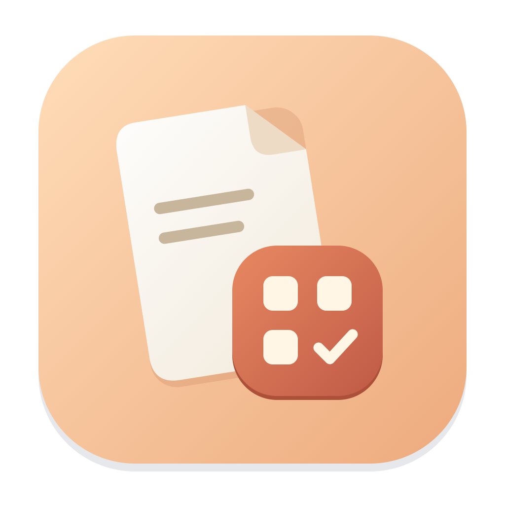
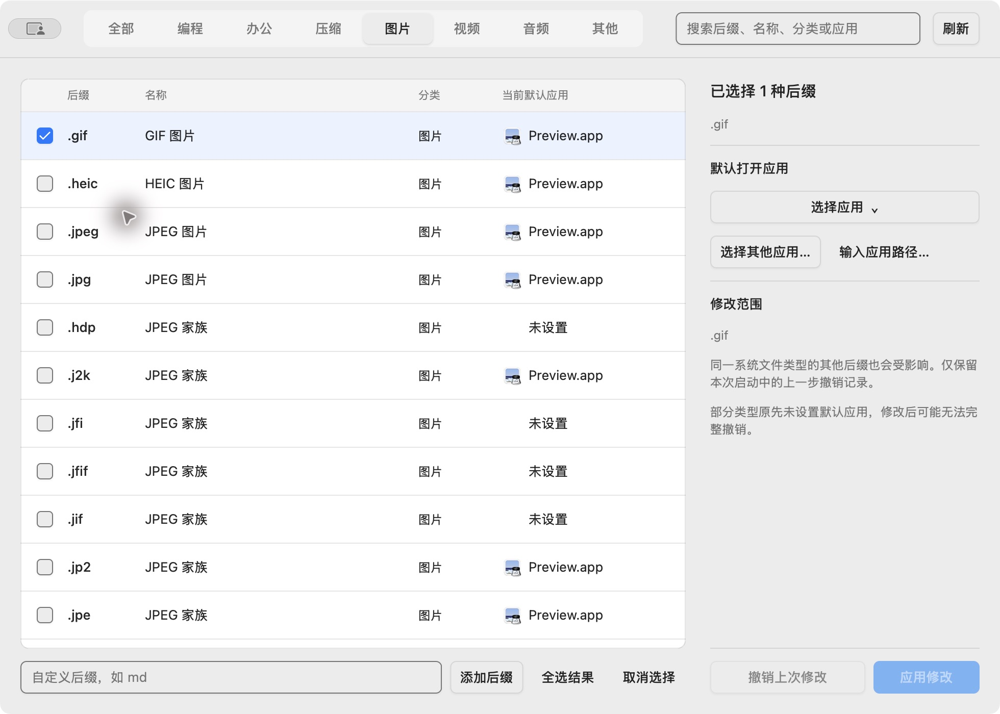

<div align="center">

<h1>Default App</h1>
<p>Choose your preferred apps for macOS file types.</p>
<p>A simple native desktop utility · 450 file extensions · Batch changes · One-step undo</p>
<p><a href="README.md">简体中文</a> | English</p>
</div>



## Download and use

Download a DMG from [Releases](https://github.com/lizhian/default-app/releases/latest): choose `arm64` for Apple Silicon (M-series) or `amd64` for Intel. Requires **macOS 13 or later**. The application UI is currently in Chinese.

Open the DMG and drag “默认打开方式” into Applications. Releases are unsigned and not notarized; macOS may block the first launch. After verifying the download source, allow it in System Settings → Privacy & Security.

1. Browse categories or search, then select rows or checkboxes. Search matches extensions, format names, categories and current default app names, ignoring case.
2. Choose an app in the right panel and apply. Alternatively, click a row’s current app to change that extension immediately.
3. Successful rows turn pale green; failed rows turn pale red. Details appear in the scope panel. Switching categories clears feedback.
4. Use Undo to restore the previous change. Only the last operation in the current session is retained.

## Features

- 450 extensions across programming, office, archives, images, video, audio and other; add custom extensions.
- Native app menus with icons, an app browser and `.app` path input.
- Click a category cell to reclassify an extension; changes persist locally.
- Sort by changes successfully made by this app, newest first, then by name. Categories, custom extensions and modification times survive restarts.
- Runs locally without background services, networking or administrator privileges.

macOS associations apply to system file types. Multiple extensions sharing a type may be affected together; the scope panel lists related extensions. Roles with no previous default may not be fully restorable; the app reports this limitation.

## Build from source

Requires Go 1.27.3+, Xcode Command Line Tools and macOS 13+.

```sh
go run ./cmd/defaultapp
./scripts/build.sh
# Package a DMG on the matching Mac architecture:
go run github.com/vivaui/viva/cmd/viva package --format dmg
```

Output: `outputs/build/`. Run `go test ./...` and `go vet ./...`. Normal tests do not change system associations. Native integration tests use random extensions and require explicit opt-in with `DEFAULTAPP_NATIVE_TEST=1`.

Pushing a version tag such as `v1.0.0` runs tests and builds DMGs on both Mac architectures, then publishes a GitHub Release with SHA-256 checksums.

## Acknowledgments and community

Thanks to [Viva](https://vivaui.dev/) for the native Go desktop UI framework. See [third-party notices](THIRD_PARTY_NOTICES.md) for file catalog sources and licenses.

Community: [LINUX DO](https://linux.do)

## License

[MIT](LICENSE)
