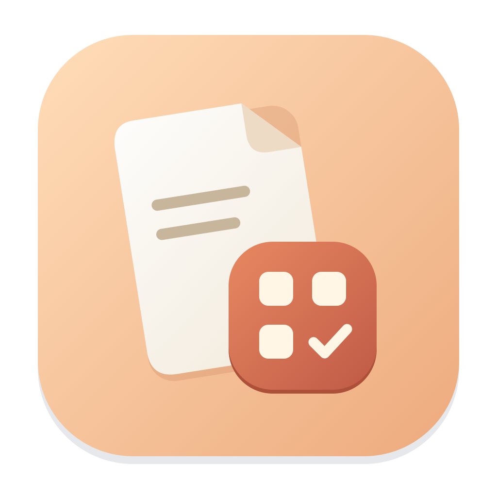
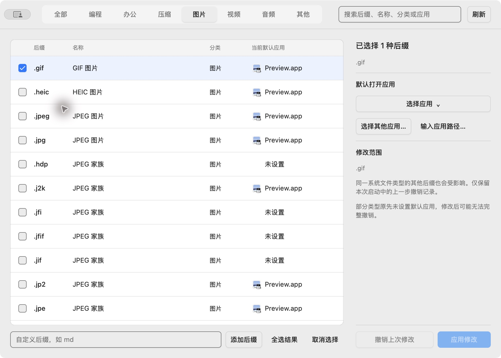

<div align="center">

<h1>默认打开方式</h1>
<p>为 macOS 文件类型，选择你习惯的应用。</p>
<p>简约的原生桌面工具 · 450 种文件类型 · 批量修改 · 一步撤销</p>
<p>简体中文 | <a href="README.en.md">English</a></p>
</div>



## 下载与使用

从 [Releases](https://github.com/lizhian/default-app/releases/latest) 下载适合你的 DMG：Apple Silicon（M 系列）选择 `arm64`，Intel Mac 选择 `amd64`。需要 **macOS 13 或更新版本**。

打开 DMG，将“默认打开方式”拖到“应用程序”。当前版本未签名、未公证；首次打开可能被 macOS 拦截。确认下载来源后，可在“系统设置 → 隐私与安全性”中允许打开。

1. 按分类或搜索找到文件类型，点击行或复选框选择。搜索支持后缀、名称、分类和当前默认应用，忽略大小写。
2. 在右侧选择应用，点击“应用修改”。也可点击列表中的当前默认应用，直接修改单个后缀。
3. 成功行淡绿、失败行淡红，详情位于“修改范围”；切换分类清除提示。
4. 需要恢复时，点击“撤销上次修改”。仅保留本次启动内的上一步撤销记录。

## 功能

- 内置 450 种后缀：编程、办公、压缩、图片、视频、音频、其他；支持自定义后缀。
- 带图标的原生应用菜单，也可浏览应用或输入 `.app` 路径。
- 点击分类即可重新分类，自动保存在本机。
- 列表按本应用成功修改时间倒序，再按名称正序；分类、自定义后缀和修改时间重启后保留。
- 本地运行，无后台服务、无网络功能，无需管理员权限。当前界面语言为中文。

macOS 的默认关联以系统文件类型为单位；同一类型的多个后缀可能一起受影响，“修改范围”会显示相关后缀。原来没有默认应用的角色可能无法完整撤销，应用会提示。

## 从源码构建

需要 Go 1.27.3+、Xcode 命令行工具及 macOS 13+。

```sh
go run ./cmd/defaultapp
./scripts/build.sh
# 在对应架构的 Mac 上打包 DMG：
go run github.com/vivaui/viva/cmd/viva package --format dmg
```

输出位于 `outputs/build/`。测试：`go test ./...`，静态检查：`go vet ./...`。普通测试不会修改系统关联；随机后缀的系统集成测试需显式设置 `DEFAULTAPP_NATIVE_TEST=1`。

推送 `v1.0.0` 这样的版本标签会通过 GitHub Actions 在两种架构的 macOS 上运行测试、构建 DMG，并自动发布 Release 和 SHA-256 校验文件。

## 致谢与社区

感谢 [Viva](https://vivaui.dev/zh/docs/) 提供 Go 原生桌面界面框架。文件类型数据的来源与许可见 [第三方声明](THIRD_PARTY_NOTICES.md)。

社区：[LINUX DO](https://linux.do)

## 许可证

[MIT](LICENSE)
